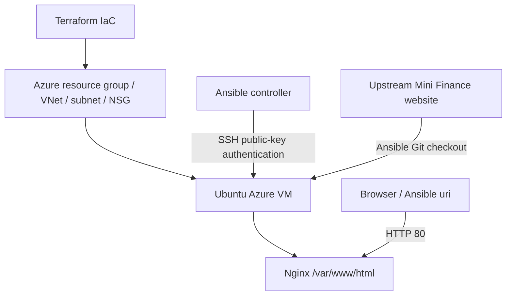
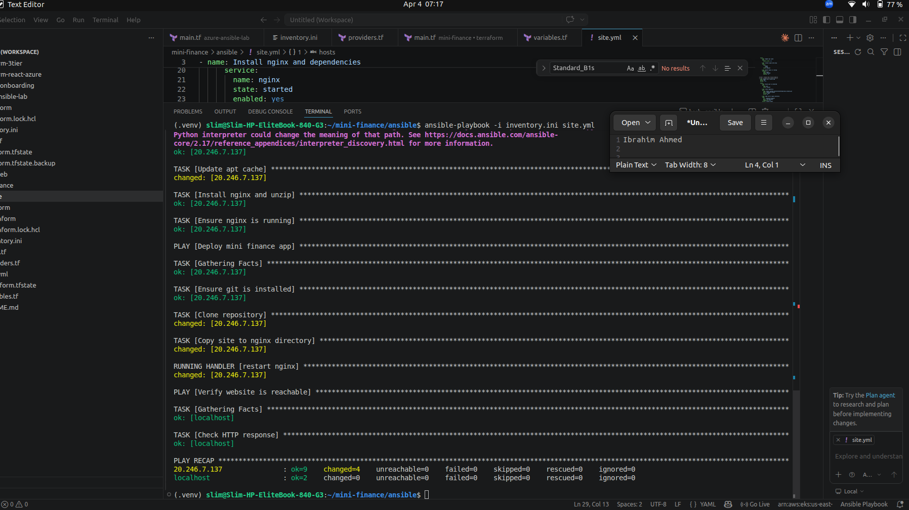
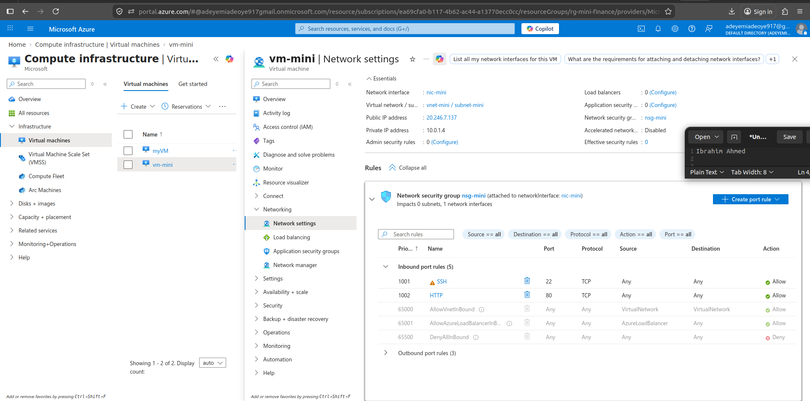
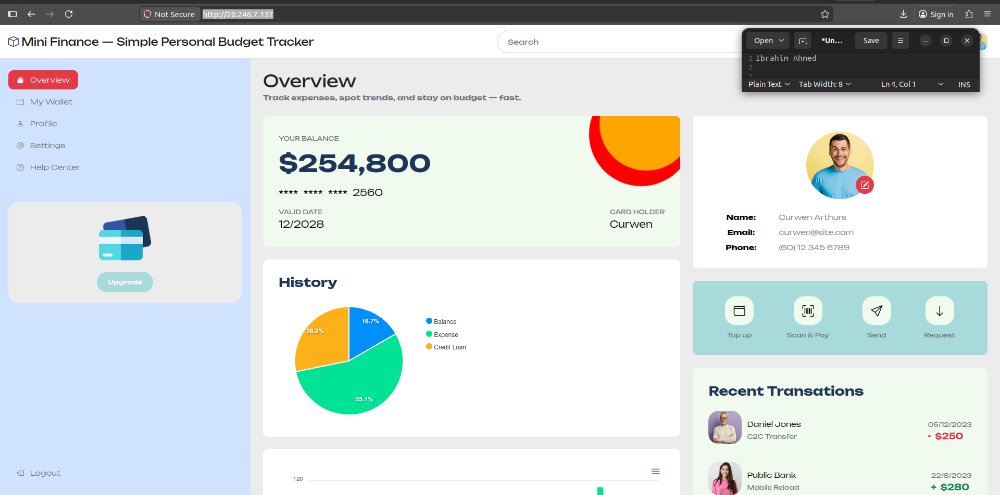

# Mini Finance on Azure — Terraform Infrastructure + Ansible Deployment

**DevOps Micro Internship (DMI), Cohort 2 · Week 12 · Assignment 4**

**Author:** Ibrahim Ahmed Abiodun  
**Platform:** Microsoft Azure  
**Scope:** Terraform infrastructure, Ansible deployment configuration, documentation and lab evidence

Azure VM provisioned with Terraform and Mini Finance static dashboard deployed with a multi-play Ansible workflow and HTTP 200 verification.

## Project overview

This repository contains the Terraform configuration used to provision Azure infrastructure, Ansible inventories and playbooks used to configure and deploy the Mini Finance static website, and supporting documentation, architecture diagrams and screenshots from the Week 12 lab. The application itself is obtained from its upstream repository and is not presented as original work. Review the configurations and adapt historical environment-specific values before redeployment.

## Tools and technologies

`Terraform`, `Azure Virtual Machines`, `Azure VNet`, `Ansible`, `Nginx`, `Git`, `SSH`, `HTTP Verification`

## Architecture

See [architecture diagram](diagrams/architecture.mmd) and [architecture notes](docs/ARCHITECTURE.md).

## Implementation summary

- **Provision Azure infrastructure:** From `mini-finance/terraform`, run `terraform init`, `terraform plan`, and `terraform apply` against authenticated Azure credentials.
- **Verify SSH:** Test `ssh azureuser@<public-ip>` using an existing trusted SSH key.
- **Run Ansible deployment:** From `mini-finance/ansible`, execute `ansible-playbook -i inventory.ini site.yml` to install Nginx, fetch Mini Finance and check HTTP.
- **Verify browser response:** Open the VM’s public IP and confirm the static dashboard renders. The report records a successful HTTP `status_code: 200`.

## Evidence from the original Week 12 report

#### Ansible playbook output

#### Mini Finance dashboard in browser

#### Azure VM network configuration

#### Mini Finance browser result

[View all 13 original screenshots](screenshots/README.md).

## Technical documentation

- [Deployment / setup procedure](docs/DEPLOYMENT.md)
- [Architecture and components](docs/ARCHITECTURE.md)
- [Verification and results](docs/VERIFICATION.md)
- [Troubleshooting](docs/TROUBLESHOOTING.md)
- [Security and GitHub publication](docs/SECURITY.md)

## Skills demonstrated

- Infrastructure provisioning
- Azure NSG and networking
- Passwordless SSH
- Ansible multi-play workflows
- Git-based web deployment
- HTTP availability checks
- Deployment debugging

## Source attribution

Training application/content source: [https://github.com/pravinmishraaws/mini_finance](https://github.com/pravinmishraaws/mini_finance). The upstream application is credited to its original maintainer; this repository documents the author’s cloud infrastructure, configuration and deployment work.

## Scope and limitations

The evidence is from a historical training environment; endpoints and public IP addresses from the report may no longer resolve or belong to the author. The report does not independently establish HTTPS, continuous monitoring, automated rollback, or production security hardening. Do not treat the lab as an actively maintained production service.

**Important:** Before publishing, review every screenshot and all local project files for confidential information; see `docs/SECURITY.md`.
