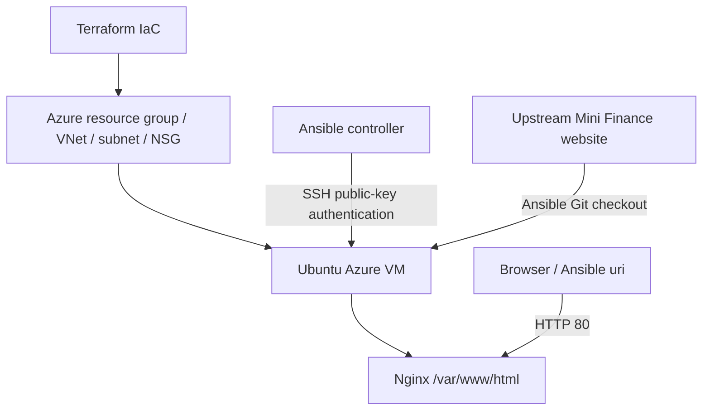

# Architecture and responsibility boundaries

## Architecture diagram

The diagram is a **simplified representation derived from the written assignment**, not a precise discovery of existing cloud resources or production networking. It should not imply additional load balancers, private subnets, HTTPS, or high availability unless supported by the user's actual code.

## Key components

- **Provision Azure infrastructure** — From `mini-finance/terraform`, run `terraform init`, `terraform plan`, and `terraform apply` against authenticated Azure credentials.
- **Verify SSH** — Test `ssh azureuser@<public-ip>` using an existing trusted SSH key.
- **Run Ansible deployment** — From `mini-finance/ansible`, execute `ansible-playbook -i inventory.ini site.yml` to install Nginx, fetch Mini Finance and check HTTP.
- **Verify browser response** — Open the VM’s public IP and confirm the static dashboard renders. The report records a successful HTTP `status_code: 200`.
