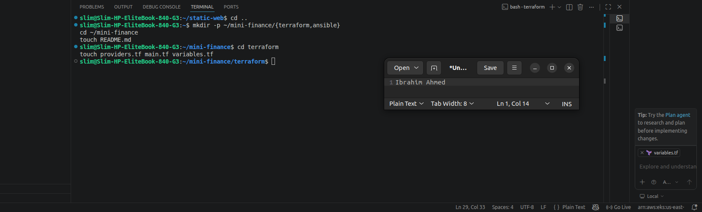
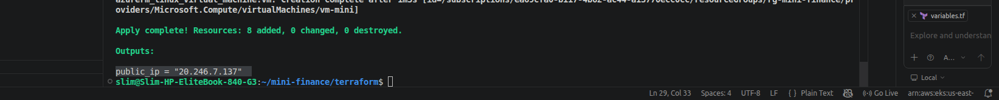
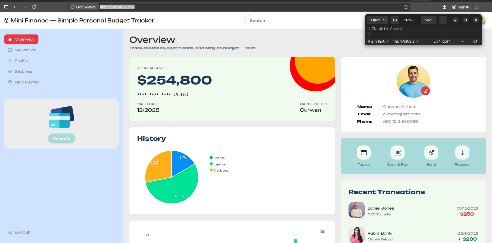
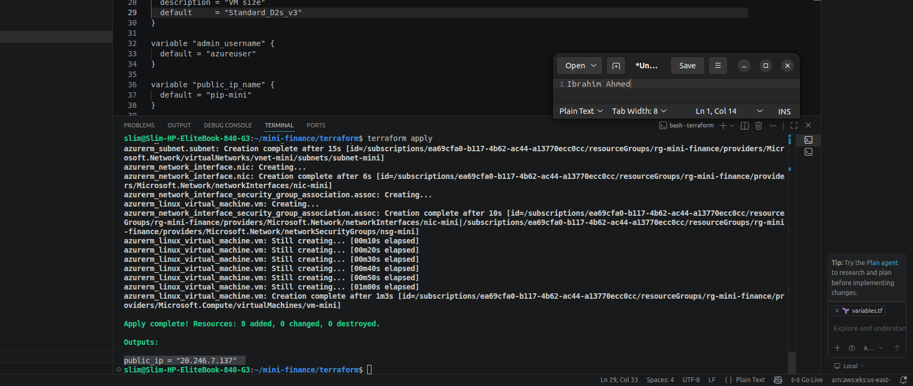
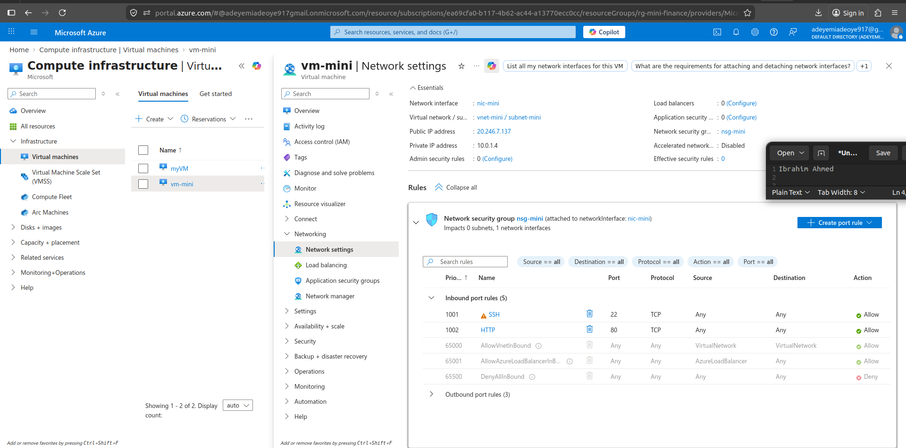
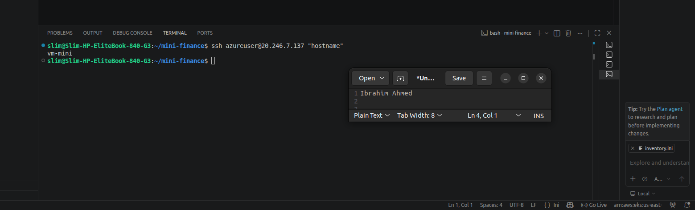
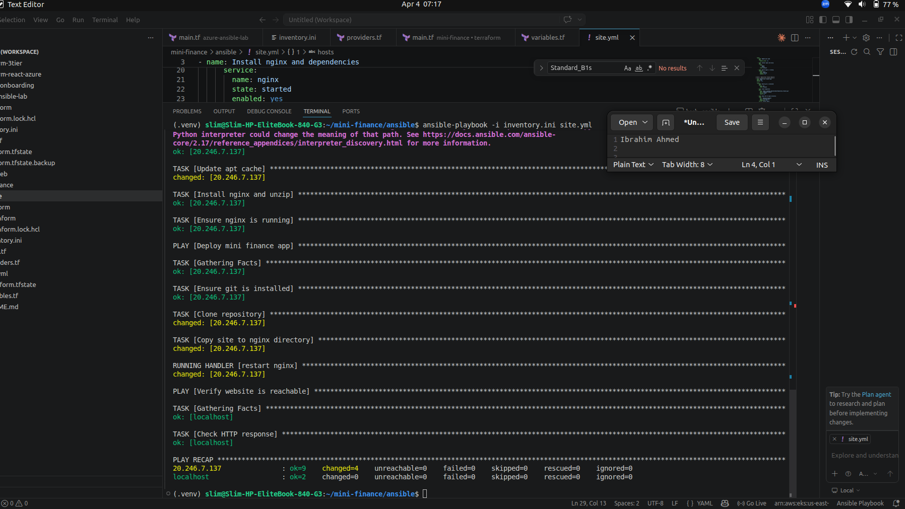
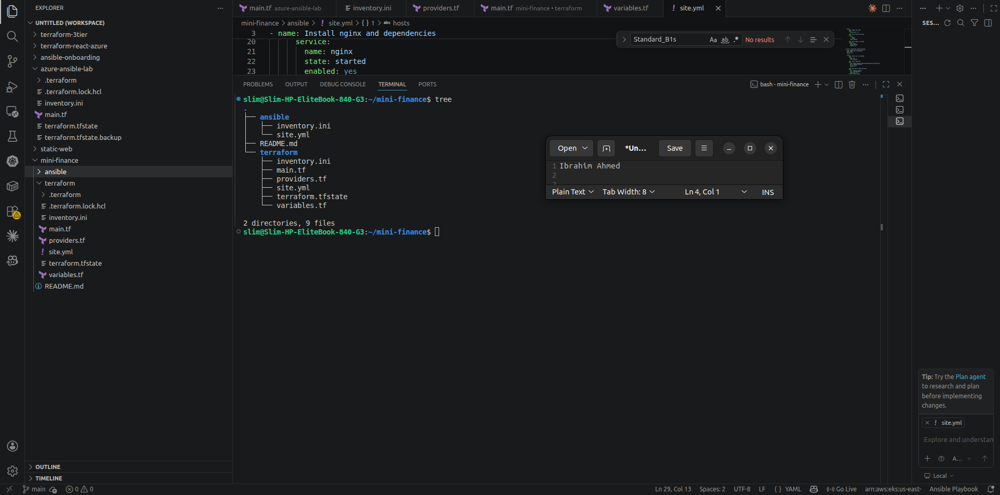
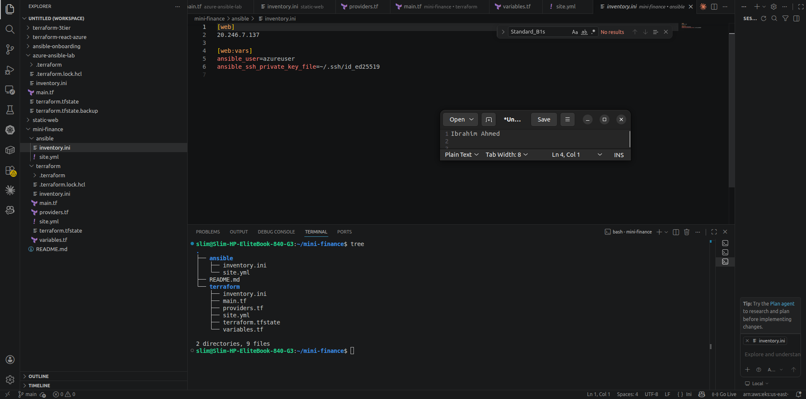
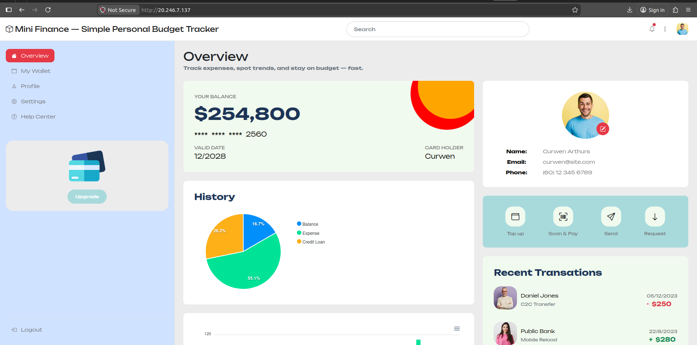

# Original screenshots — Assignment 4

The 13 images below were extracted **directly from the uploaded Week 12 Word report**. Their original image bytes and dimensions are preserved. Evidence documents historical lab execution, **not a currently running service**.

Before publishing, manually inspect the images for email addresses, cloud account/subscription IDs, live credentials, private keys and personal identifiers. Redact sensitive details while preserving the technical proof and required visible name.

### 01. Mini Finance project setup

Original embedded Word image: 1639 × 497 pixels.

### 02. Terraform apply evidence

Original embedded Word image: 1681 × 712 pixels.

### 03. Ansible playbook output

Original embedded Word image: 1796 × 1011 pixels.

### 04. Mini Finance dashboard in browser

Original embedded Word image: 1920 × 952 pixels.

### 05. Terraform resource summary

Original embedded Word image: 1681 × 712 pixels.

### 06. Azure VM network configuration

Original embedded Word image: 1920 × 952 pixels.

### 07. SSH access verification

Original embedded Word image: 1559 × 473 pixels.

### 08. Ansible playbook execution

Original embedded Word image: 1796 × 1011 pixels.

### 09. Mini Finance browser result

Original embedded Word image: 1920 × 952 pixels.

### 10. Project folder structure

Original embedded Word image: 1920 × 952 pixels.

### 11. Inventory / playbook structure

Original embedded Word image: 1920 × 952 pixels.

### 12. Website end-user validation

Original embedded Word image: 1920 × 952 pixels.

### 13. LinkedIn project post evidence

Original embedded Word image: 647 × 703 pixels.
